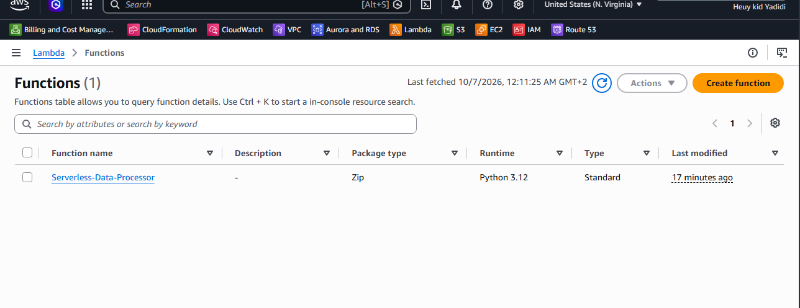
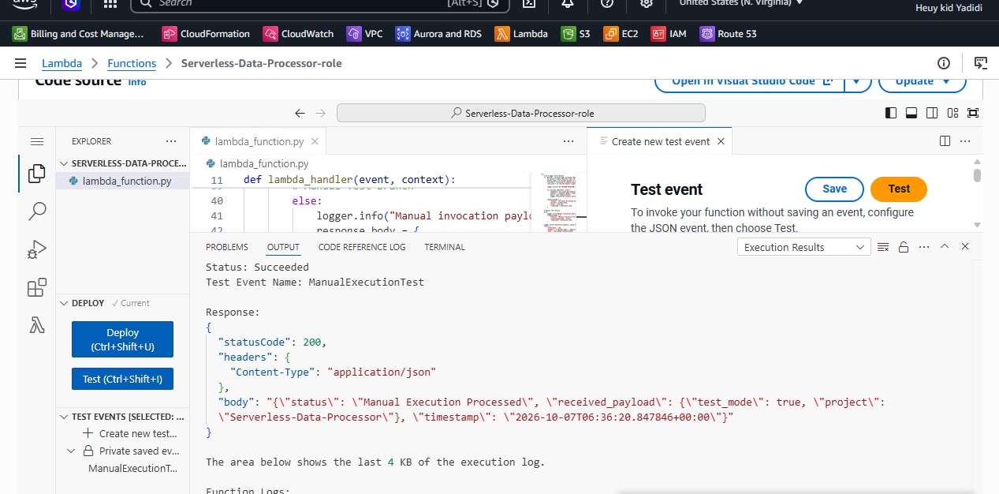
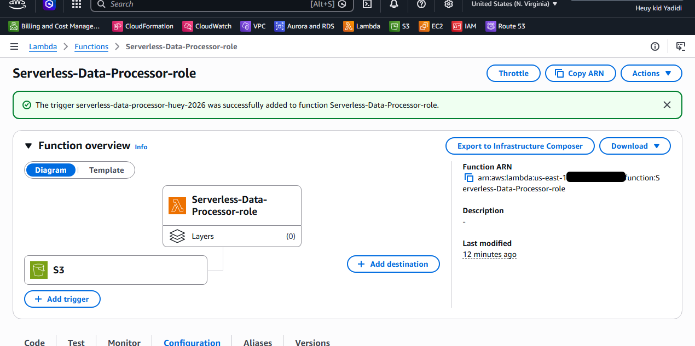
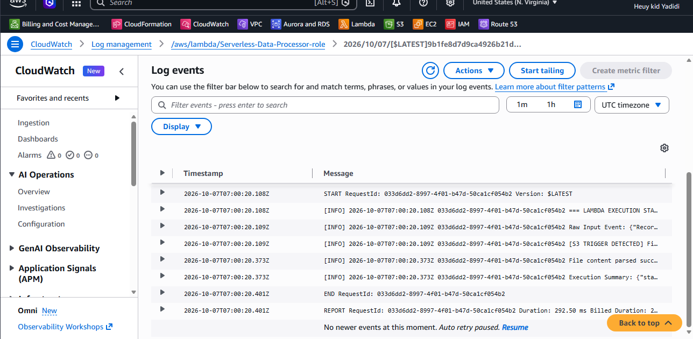

# Project 12 — Serverless Data Processor (Lambda + S3 + CloudWatch)

## Overview
My first serverless project. I wrote a small Python function that runs on AWS Lambda. When I upload a `.json` file to an S3 bucket, S3 automatically triggers the function. The function reads the file, parses it, and writes what it did to CloudWatch Logs. There is no server for me to run or pay for while it's idle. I'm still learning Lambda, so this README records what I built and what I understood.

## Stack
AWS Lambda (Python 3.12) · Amazon S3 · Amazon CloudWatch Logs · AWS IAM · boto3 · AWS Management Console

## What I practiced
- Creating a Lambda function and deploying Python code in the console
- Testing a function by hand with a JSON test event
- Giving the function's IAM role the permissions it needs (logs and S3 read)
- Creating an S3 bucket and adding it as a Lambda trigger
- Uploading a file and checking the result in CloudWatch Logs
- Understanding the difference between an event, a handler and a log

## Configuration
| Item | Value |
|---|---|
| Function name (as shown in my screenshots) | `Serverless-Data-Processor-role` |
| Runtime | Python 3.12 |
| Handler | `lambda_function.lambda_handler` |
| Architecture | x86_64 |
| Trigger | S3, `All object create events` (`s3:ObjectCreated:*`) |
| Bucket | `serverless-data-processor-huey-2026` |
| Test event | `ManualExecutionTest` |
| Role policies | `AWSLambdaBasicExecutionRole` (logs) and `AmazonS3ReadOnlyAccess` (read files) |
| Region | us-east-1 |

## Project structure
```text
12-lambda/
├── project/
│   ├── lambda_function.py     # the handler I deployed
│   ├── test-event.json        # manual test event (ManualExecutionTest)
│   └── sample-data.json       # file I uploaded to S3
├── documentation/
│   ├── Lambda-Journal.md
│   └── Lambda-Notes.md
├── architecture/
│   └── Lambda-Architecture-Diagram.md
├── screenshots/
│   ├── 01-lambda-function-setup.png
│   ├── 02-lambda-code-and-manual-test.png
│   ├── 03-s3-bucket-and-trigger.png
│   └── 04-s3-automated-trigger-and-cloudwatch-logs.png
└── README.md
```

## Architecture
```text
Upload sample-data.json
        |
        v
  +-------------+   s3:ObjectCreated:*   +------------------+
  |  S3 bucket  | ---------------------> |  Lambda function |
  +-------------+     (event as JSON)    |  (Python 3.12)   |
        ^                                +--------+---------+
        |                                         |
        +------------ reads the .json ------------+
                      (get_object)                |
                                                  v
                                       +--------------------+
                                       | CloudWatch Logs    |
                                       | /aws/lambda/<name> |
                                       +--------------------+
```

## Screenshots

### 1. Function setup


### 2. Code and manual test (statusCode 200)


### 3. S3 trigger attached


### 4. Automatic run in CloudWatch Logs


## What I did
1. Created a Lambda function (Python 3.12) with the console's "Author from scratch".
2. Opened its execution role in IAM and attached `AmazonS3ReadOnlyAccess`, next to the logging policy that was already there.
3. Pasted the code into `lambda_function.py` and clicked **Deploy**.
4. Created the test event `ManualExecutionTest` and ran **Test**. It returned `statusCode: 200`.
5. Created the S3 bucket `serverless-data-processor-huey-2026`.
6. Added the S3 trigger (all object create events) and accepted the recursive invocation warning.
7. Uploaded `sample-data.json` to the bucket.
8. Opened CloudWatch Logs and found `[S3 TRIGGER DETECTED]` and `File content parsed successfully` for my file. The run took about 292 ms.

## What the code does
1. It sets up a logger so every `logger.info` line goes to CloudWatch.
2. `lambda_handler(event, context)` is the entry point. Lambda calls it and passes the event.
3. It checks whether the event has S3 `Records`.
4. **S3 branch:** it takes the bucket name and file name, reads the file with `get_object` if the name ends in `.json`, parses it and logs the content.
5. **Manual branch:** if there are no S3 records (my manual test), it logs "Manual invocation payload received" and returns my test JSON back.
6. It returns `statusCode: 200` and a JSON body, or logs the error and raises it if something fails.

## Key ideas (in my own words)
- **Serverless:** I don't manage a server. AWS runs my code only when something calls it.
- **Event:** a JSON message saying "something happened". The S3 upload created one for my function.
- **Trigger:** the link that says "when this happens, run that function".
- **Handler:** the function Lambda calls first (`lambda_function.lambda_handler`).
- **Execution role:** the IAM role the function runs as. It needs permission for logs and for reading S3.
- **CloudWatch Logs:** where the function's output goes, since there is no screen to look at.
- **Python `lambda` vs AWS Lambda:** the Python keyword is a tiny one-line function inside code. AWS Lambda is the cloud service that runs my code. They only share a name.

## Challenge
- I wasn't sure where to put the JSON test event. I first looked under Runtime settings and Layers (wrong). It belongs in the **Test** tab (or the dropdown next to the Test button).
- The console layout was different from the instructions I was following, so I had to match what I saw to what I was told.
- My first attempt got messy and Deploy complained, so I deleted the function, its IAM role and the bucket and started again. This is a good habit when a lab gets tangled.

## Validation checklist
- [x] Function created (Python 3.12) and code deployed
- [x] Manual test passed with `statusCode: 200`
- [x] Role has logging and S3 read permissions
- [x] S3 bucket created
- [x] S3 trigger added to the function
- [x] Uploading `sample-data.json` triggered the function automatically
- [x] Logs in CloudWatch show the S3 event and the parsed file
- [ ] Permissions narrowed to this one bucket (not done)
- [ ] Failure case tested, for example a non-JSON file or bad JSON (not done)

## Notes
`AmazonS3ReadOnlyAccess` lets the function read every bucket in the account, which is more than it needs. A better version would be a small policy that allows `s3:GetObject` on this bucket only. I haven't done that yet.

Lambda is billed per use and has a free tier, but I still delete the bucket and the function when I'm done, and I check Billing.

Documentation was written with AI assistance (Claude) for structure and clarity. I built the lab in the AWS Console myself and checked what is written here against what I did.
