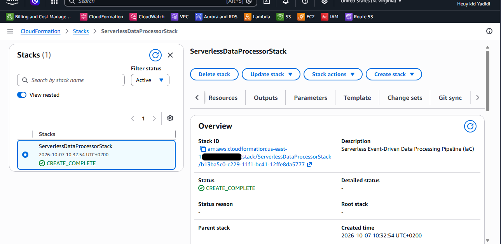
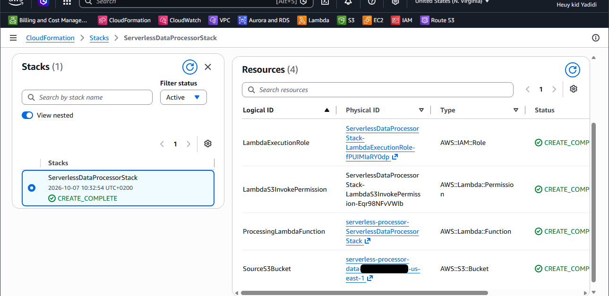
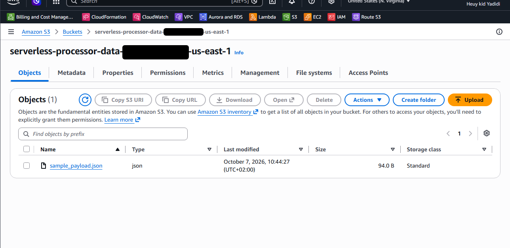
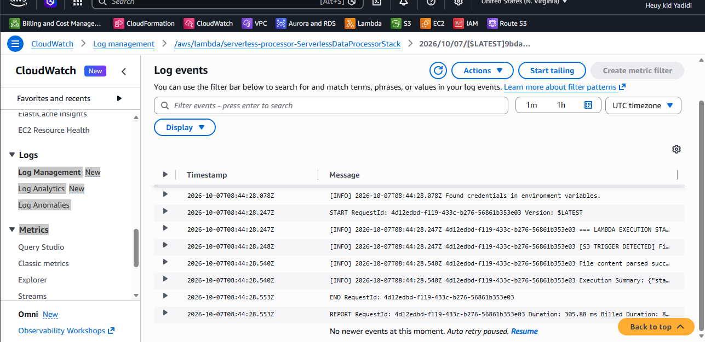

# Project 13 — Serverless Pipeline with CloudFormation (Infrastructure as Code)

## Overview
In Project 12 I built a serverless pipeline by clicking through the AWS Console: an S3 bucket that triggers a Python Lambda function, which writes to CloudWatch Logs. Here I built the same pipeline again from one YAML file, using AWS CloudFormation. One template creates the IAM role, the Lambda function, the permission and the S3 bucket with its trigger. I'm still learning CloudFormation, and my first attempts failed before I got it working, so I wrote that down too.

## Stack
AWS CloudFormation (YAML) · AWS Lambda (Python 3.12) · Amazon S3 · AWS IAM · Amazon CloudWatch Logs · AWS Management Console

## What I practiced
- Writing and reading a CloudFormation template (Resources and Outputs)
- Using `!Ref`, `!GetAtt`, `!Sub` and `DependsOn`
- Creating a stack and acknowledging IAM capabilities
- Reading rollback failures and fixing the template
- Testing the result by uploading a JSON file and reading the logs
- Seeing how a stack makes cleanup easier

## Configuration
| Item | Value |
|---|---|
| Stack name | `ServerlessDataProcessorStack` |
| Template | `project/template.yaml` |
| Resources | IAM role, Lambda function, Lambda permission, S3 bucket |
| Lambda | Python 3.12, x86_64, timeout 30 s, name `serverless-processor-<stack name>` |
| Handler | `index.lambda_handler` (the code is inline in the template) |
| Bucket name | `serverless-processor-data-<ACCOUNT_ID>-<region>` |
| Trigger | `s3:ObjectCreated:*` |
| Role policies | `AWSLambdaBasicExecutionRole` and `AmazonS3ReadOnlyAccess` |
| Test file | `project/sample-payload.json` |
| Region | us-east-1 |

## Project structure
```text
13-cloudformation/
├── project/
│   ├── template.yaml          # the CloudFormation template
│   └── sample-payload.json    # test file I uploaded
├── documentation/
│   ├── CloudFormation-Journal.md
│   └── CloudFormation-Notes.md
├── architecture/
│   └── CloudFormation-Architecture-Diagram.md
├── screenshots/
│   ├── 01-cloudformation-stack-create-complete.png
│   ├── 02-cloudformation-stack-resources.png
│   ├── 03-s3-file-upload.png
│   └── 04-cloudwatch-log-verification.png
└── README.md
```

## Architecture
```text
+------------------- CloudFormation stack: ServerlessDataProcessorStack -------------------+
|                                                                                          |
|  Upload sample-payload.json                                                              |
|          |                                                                               |
|          v         s3:ObjectCreated:*          +--------------------------+              |
|  +---------------+ ----------------------->   | Lambda function          |              |
|  | S3 bucket     | <---- reads the file ----  | (Python 3.12)            |              |
|  +---------------+                            +------------+-------------+              |
|          ^                                                  |                            |
|          | allowed by                                       | logs                       |
|  +-------+---------------+                                  v                            |
|  | Lambda permission     |                      +--------------------------+            |
|  +-----------------------+                      | CloudWatch Logs          |            |
|                                                 +--------------------------+            |
|  IAM role (logs + S3 read) is used by the Lambda function                                |
+------------------------------------------------------------------------------------------+
```

## Screenshots

### 1. Stack created (CREATE_COMPLETE)


### 2. Resources created by the stack


### 3. Test file uploaded to the bucket


### 4. Lambda ran automatically (CloudWatch Logs)


## What I did
1. Saved the template as `template.yaml`.
2. In CloudFormation chose **Create stack, With new resources**, uploaded the file and named the stack `ServerlessDataProcessorStack`.
3. Ticked the box acknowledging that CloudFormation may create IAM resources, left the other options at their defaults, and submitted.
4. My first attempts failed and rolled back. I fixed the template and tried again (see Challenge).
5. The stack reached **CREATE_COMPLETE**. I checked the Outputs and Resources tabs.
6. Uploaded `sample-payload.json` to the bucket that the stack created.
7. Opened the Lambda function's log group in CloudWatch and found `[S3 TRIGGER DETECTED]`, the parsed JSON and the execution summary.

## Key ideas (in my own words)
- **Infrastructure as Code:** I describe what I want in a file, and AWS builds it. The file can go on GitHub and be reused.
- **Declarative:** I say what the end result should be, not each click.
- **Stack:** everything created from one template. Deleting the stack deletes its resources.
- **`!Ref`, `!GetAtt`, `!Sub`:** `!Ref` gives a name or ID, `!GetAtt` gives a property such as an ARN, `!Sub` fills variables into text.
- **`DependsOn`:** build this only after that.
- **Rollback:** if a step fails, CloudFormation removes what it already created so nothing half-built is left.
- **Capabilities box:** CloudFormation asks me to confirm when a template creates IAM resources.

My one-sentence rule: **a template describes the resources, CloudFormation builds them in the right order, and deleting the stack removes them.**

## Challenge
**Stack creation failed and rolled back.** My first attempts failed, and one time CloudFormation said "1 Deployment validations failed". What finally worked was fixing the Lambda property `Architecture` to `Architectures`, which has to be a list (`- x86_64`). I didn't save the exact first error message, so I can't be fully sure it caused the very first rollback. A failed stack in `ROLLBACK_COMPLETE` has to be deleted before I can reuse the same name.

**Circular dependency.** The S3 bucket needs the Lambda permission, and the permission needs the bucket's ARN. To avoid a loop, the permission builds the bucket ARN from its name with `!Sub` instead of pointing at the bucket resource. `DependsOn` then makes sure the permission exists before the bucket's trigger is added.

**Lesson:** read the Events tab for the real error message and save it, instead of guessing.

## Validation checklist
- [x] Template written and valid YAML
- [x] Stack reached CREATE_COMPLETE
- [x] Four resources created (role, function, permission, bucket)
- [x] JSON file uploaded to the stack's bucket
- [x] Lambda triggered automatically and parsed the file
- [x] Screenshots captured
- [ ] Stack deleted and log group removed (cleanup)
- [ ] Permissions narrowed to this one bucket (not done)

## Notes
- **Cleanup:** empty the bucket first, because CloudFormation can't delete a bucket that has files in it. Then delete the stack. The Lambda log group isn't part of the stack, so it stays behind (retention "Never expire") unless I delete it myself in CloudWatch.
- **Least privilege:** `AmazonS3ReadOnlyAccess` lets the function read every bucket in the account. A narrower policy for this bucket only would be better. I haven't done that yet, so I don't claim least privilege.
- Since the IAM role has no custom name in the template, the plain IAM capability is enough.
- I keep my account ID out of the repo, and the screenshots need the account ID hidden.

Documentation was written with AI assistance (Claude) for structure and clarity. I did the lab in the AWS Console myself and checked what is written here against what I did.
