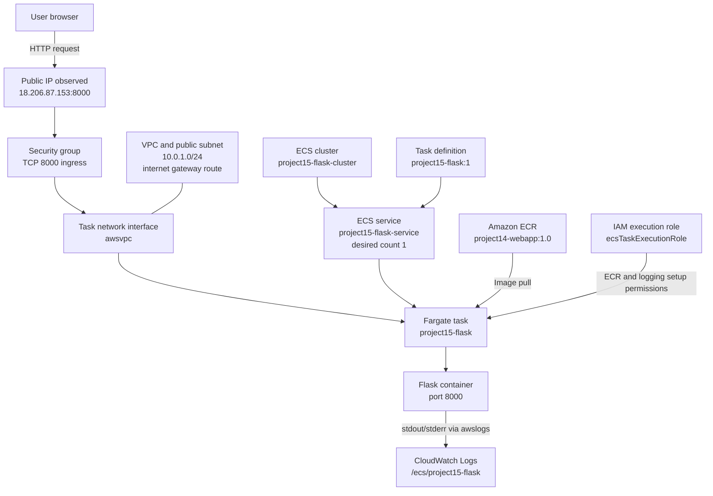

# Project 15 Architecture Diagram

## How to read it
- Browser traffic reaches the task's public IP on TCP 8000.
- The task is managed by an ECS service in an ECS cluster.
- The task definition specifies image, port, CPU/memory, execution role and log configuration.
- ECR stores the image pulled at task startup.
- The task receives an ENI in the VPC subnet.
- Container logging is configured for CloudWatch Logs; actual events still need verification.
- The public IP may change if the task is replaced.
